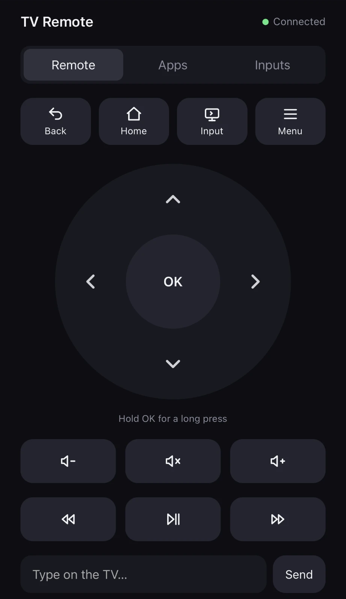
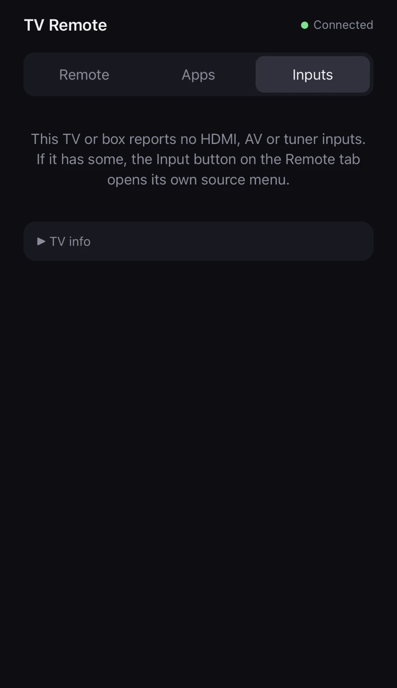
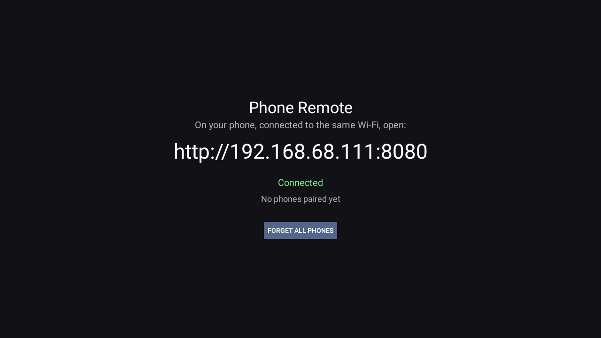
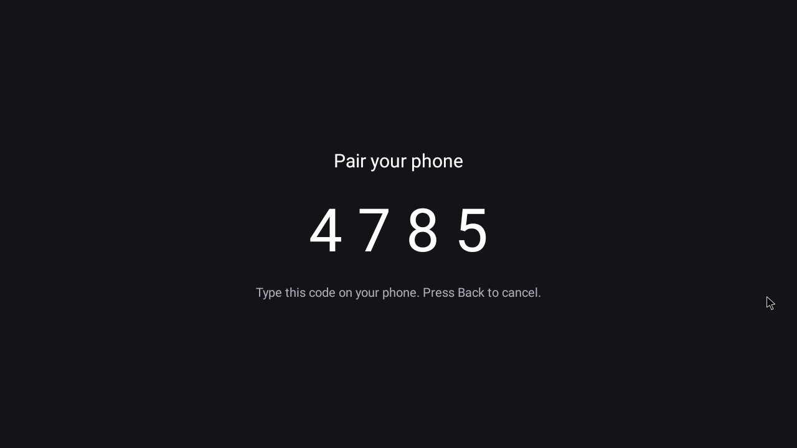

# Phone Remote for Android TV

Turn any phone into a remote for an Android TV box. A small app on the box serves a web page at
`http://<box ip>:8080`: scan the QR code on the TV, and you get a D-pad or a swipe touchpad, volume and
media keys, a mouse pointer for apps not made for TVs, typing into search fields, a live view of the screen,
your favourite apps one tap away, and an on/off button. Nothing to install on the phone, no account, no cloud.

Made as an add-on for [Glass TV](https://github.com/cocombee/glass-tv), but it works with any launcher.

<p>
  
  
</p>

<p>
  
  
</p>

## What you get

- **Scan to start:** the TV shows a QR code for the page, and the pairing screen's QR code pairs the
  phone in one scan. Typing the 4-digit code works too.
- **Remote tab:** Back, Home, Input, Menu; a round D-pad that repeats while held; OK, where a hold is a
  real long press (Glass TV's Move / App info menu opens from the phone); volume and mute; rewind,
  play/pause, fast-forward; Delete, Enter and Settings. **Input** sends the remote's Input/Source key,
  so the TV opens its own source menu.
- **Touchpad mode:** swipe anywhere to move the selection, tap for OK, hold for a long press. One hand,
  no aiming. The phone remembers which mode you like.
- **Mouse mode:** a real pointer on the TV, like a laptop trackpad: slide to move (faster swipes go
  further), tap to click, hold for right-click (Back), two fingers to scroll. Handy in apps made for
  phones, like the phone Play Store, YouTube or Chrome. The box sees it as a USB mouse, which appears when
  you first move it and goes away after two idle minutes. On a TV that doesn't allow that, Phone Remote
  draws its own pointer instead and clicks with taps, and the phone page says so.
- **Show the TV screen:** a live picture of what's on the TV, every couple of seconds while it's open.
  Netflix and other protected video show black, as in any screenshot.
- **Favourites:** up to six apps in a row at the top of the Remote tab. Star them in the Apps tab
  (Edit favourites); they're kept on the box, so every phone sees the same row.
- **On/off:** the button in the header puts the box to sleep and wakes it again, and the header says
  when it's asleep. See [On/off](#onoff) for why it doesn't use the power key.
- **Type on the TV:** text you type on the phone goes into whatever field has focus on the TV.
- **Apps tab:** every app the TV can open, TV apps and phone-only apps alike, with its icon. Hold one
  to see its package name.
- **Inputs tab:** on a TV (Xiaomi, TCL, Sony…), its HDMI ports, AV and tuner with a dot for what is
  plugged in; one tap switches. Streaming boxes have no inputs and say so.
- **Siri & Shortcuts:** make a key on the phone page and control the TV from the iPhone Shortcuts app
  or Siri ("Open SmartTube on the TV"). See [Siri & Shortcuts](#siri--shortcuts).
- **TV info** (under Inputs): what the TV reports about its inputs and which app switches them; a
  screenshot of it is the most useful thing to put in an issue. **Forget this phone** is there too.
- **Add to Home Screen:** on iPhone (Share → Add to Home Screen) or Android, the page becomes an app
  with its own icon that opens full screen. On iPhone the home-screen app keeps its own sign-in, so pair
  it once more the first time you open it.
- **Fast:** keys go over one open WebSocket, about 13 ms from tap to key press on the TV over Wi-Fi
  (40 ms over plain requests, which the page falls back to if the socket drops).
- **Starts with the box:** after a reboot the page is back within a minute, with nothing to open.

## Install

Download `PhoneRemote-v<version>.apk` from [Releases](https://github.com/mozaiz/glass-tv-phone-remote/releases)
and check it against the `.sha256` next to it. The box needs Android 8 or newer and network (ADB)
debugging on. Install it over the network:

```bash
adb connect <box ip>:5555
adb install -r PhoneRemote-v1.1.0.apk
adb shell am start -n com.zmk.tvremote/.MainActivity
```

The TV asks **Allow USB debugging?** for "Phone Remote": tick **Always allow** and press OK. Then scan
the QR code on the TV with your phone. With [Glass TV](https://github.com/cocombee/glass-tv)'s tools
instead of `adb`: `tools/venv/bin/python -I tools/b64push.py PhoneRemote-v1.1.0.apk /data/local/tmp/r.apk`
and `tools/tv.py 'pm install -r /data/local/tmp/r.apk'`.

Updates install over the old version and keep your paired phones. Uninstall:
`adb shell pm uninstall com.zmk.tvremote`.

## Build

JDK 17 and Android SDK platform 34 + build-tools 34.0.0:

```bash
echo "sdk.dir=$ANDROID_HOME" > local.properties
./gradlew assembleRelease
```

Without a `keystore/` folder the build is signed with your debug key, which can't install over a
release from this repository (Android refuses an update signed with a different key); uninstall first.

Every push builds on GitHub Actions; pushing a tag such as `v1.2.0` publishes a release, signed with the
release key from the repository secrets (`RELEASE_KEYSTORE_B64`, `RELEASE_STORE_PASSWORD`,
`RELEASE_KEY_ALIAS`, `RELEASE_KEY_PASSWORD`).

## How it works

Android lets no ordinary app press keys in other apps. The box's own debugging service can, so on
first start the app connects to it at `127.0.0.1:5555` (the TV asks **Allow USB debugging?** once) and
starts a tiny helper from its own APK with `app_process`, the way
[scrcpy](https://github.com/Genymobile/scrcpy) does. The helper stays running as the shell user, injects
each key through Android's InputManager, opens apps with `am start`, and takes screenshots for the live
view (scaled to 640 px wide and sent back as JPEG). For Mouse mode it creates a virtual USB mouse with
Android's own `hid` tool (`/dev/uhid`, which the shell user may open), so Android draws its real pointer;
injected mouse events alone would click but show no pointer. The helper checks that Android really added
the mouse; where it didn't (a TV whose shell may not create HID devices), Phone Remote draws its own arrow
over everything (the helper grants it the overlay permission), keeps the position itself, and sends taps
and wheel events to that spot. `adb shell setprop debug.tvremote.nohid 1` forces this fallback for testing.

Inputs come from Android's TV input framework (`TvInputManager`), the same way
[Glass TV](https://github.com/cocombee/glass-tv)'s Inputs menu reads them on Xiaomi, TCL and Sony sets.
Switching is the standard `ACTION_VIEW` on the input's channel URI
(`content://android.media.tv/passthrough/<input id>`, type `vnd.android.cursor.item/channel`), which
the TV's Live TV app handles (on Xiaomi, `com.mitv.livetv`).

- `RemoteService`: foreground service started at boot; owns the web server and the link, and keeps the
  CPU and Wi-Fi up while the TV sleeps.
- `HttpServer`: a small HTTP/1.1 server for the page, its JSON API and the WebSocket.
- `Adb`: one long-lived connection to the box's debugging service (protocol adapted from Glass TV's
  `CacheCleaner`, MIT).
- `Injector`: the helper that runs as the shell user and presses keys.
- `Pairing`: 4-digit codes, per-phone tokens and Shortcuts keys.
- `TvInputs`: the TV's inputs, their state, and which app switches them.
- `Qr`: the QR codes on the TV (ZXing, Apache 2.0).
- `app/src/main/assets/index.html`: the phone page, one file, no dependencies.

### On/off

The remote's power key (`KEYCODE_POWER`, 26) puts some boxes into a standby that switches Wi-Fi off,
and then no phone can wake them; on the test box it dropped off the network within five seconds. So
the on/off button sends `KEYCODE_SLEEP` (223) while the box is awake and `KEYCODE_WAKEUP` (224) while
it sleeps, and the server turns a 26 from anywhere (a Shortcut, say) into the same pair. Plain sleep
alone still lost the network after about three minutes; with the service holding a partial wake lock
and a Wi-Fi lock, the test box stayed reachable through six minutes of sleep and woke from the phone.
TV boxes run on mains power, so keeping the CPU up costs a few watts at most.

## Siri & Shortcuts

On the phone page, **Inputs → Siri & Shortcuts → Create a key for Shortcuts**. The key is shown once
and works like a paired phone; **Forget all phones** on the TV removes every key too. In the iPhone
Shortcuts app add **Get Contents of URL**:

| Field | Value |
|---|---|
| URL | `http://<box ip>:8080/api/launch` |
| Method | POST |
| Headers | `Authorization: Bearer <your key>` and `X-Remote: 1` |
| Request Body | Form: `pkg` = the app's package name (hold an app in the Apps tab to see it) |

Name the shortcut ("Open SmartTube on the TV") and say it to Siri. Other actions:

| Action | URL | Form |
|---|---|---|
| A key | `/api/key` | `code`: 24 volume up, 25 down, 164 mute, 85 play/pause, 3 Home, 4 Back, 26 on/off |
| Long press | `/api/key` | `code`, `long` = `1` |
| Type | `/api/text` | `t` = the text |
| Switch input | `/api/input` | `id` = an input id from TV info |

## Security

- **Pairing:** the first time a phone connects, the TV shows a 4-digit code and a QR code with the same
  code; the phone that uses it gets a random 256-bit token in an `HttpOnly`, `SameSite=Strict` cookie. A
  code lasts two minutes and five wrong guesses throw it away. Every API call except pairing needs the
  token or a Shortcuts key.
- **Other websites can't press keys:** every POST needs an `X-Remote` header, which a page on another
  site can't send without a CORS preflight that this server never answers, and the WebSocket only
  accepts the page's own origin and a paired phone.
- **Forget this phone** on the page, and **Forget all phones** on the TV (phones and Shortcuts keys).
- The live screen view is only for paired phones, like everything else.
- It listens on your local network only, over plain HTTP. Don't forward port 8080 to the internet.
- It needs **network debugging left on** on the box. Anyone you let past the TV's debugging prompt
  can control the box anyway; this app adds no new way in beyond the paired phones and keys.

## Tested on

A generic Allwinner H618 box (model MBOX), Android 10 TV (SDK 29), 1280x720, with Glass TV as Home:

- Pairing by code and by the QR code's link; the QR codes decode to the right address.
- Keys, long press, typing into a TV text field, the app list and launching, favourites.
- The WebSocket: 12 of 12 presses answered, 13 ms on average; other origins and unpaired clients are
  refused.
- Live screen: about 1 s and 18 KB per frame.
- A Shortcuts key with no cookie presses keys; a wrong key is refused; forgetting it revokes it.
- On/off: asleep and still reachable for six minutes, woken from the phone; the power-key path is
  turned into sleep/wake.
- Mouse: the pointer appears and moves, a click opened Nuvio from Glass TV's dock, a right-click went
  Back, the wheel scrolled the Home grid, and the virtual mouse is removed after two idle minutes. With
  the fallback forced, Phone Remote's own arrow appeared where expected and the same click, Back and
  scroll worked.
- Starting again after a reboot, and updating over the previous version with phones still paired.
- Input switching on this box, which has no HDMI inputs of its own: the Input key reaches Android's
  input dispatcher, and a test app that registers a TV input and takes the switch intent like a Live TV
  app received exactly `ACTION_VIEW`, `vnd.android.cursor.item/channel`,
  `content://android.media.tv/passthrough/<id>`, with the id intact.

**Not yet tried:** switching to a TV's own HDMI ports (only a TV's own system can create HDMI inputs, so
no box or emulator can stand in), touchpad and mouse modes on a real phone, Mouse mode on other boxes (the fallback was only tested by
forcing it), and the on/off button on other boxes.
If you have a Xiaomi, TCL or Sony Android TV, please try the Inputs tab and open an issue with what
happened and a screenshot of TV info.

## Licence

MIT, see [LICENSE](LICENSE). The ADB client is adapted from
[Glass TV](https://github.com/cocombee/glass-tv) / [CleanYourTV](https://github.com/Gathin23/cleanyourtv) (MIT).
QR codes are made with [ZXing](https://github.com/zxing/zxing) (Apache 2.0).
